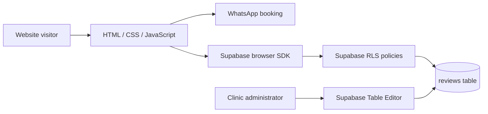

<div align="center">

# 🌿 AlShifa Care
### Hijama • Homeopathy • Wellness

**A responsive bilingual wellness website with appointment links and moderated patient reviews.**

    

</div>

## Overview

AlShifa Care is a mobile-friendly clinic information website for Hijama (cupping), homeopathic consultations, and wellness services. The original green/teal visual identity, Urdu content, imagery and WhatsApp booking links are retained. The frontend is **plain HTML, CSS and JavaScript**, hosted as static files on Netlify. A Supabase-backed reviews section allows visitors to submit reviews that appear publicly **only after approval**.

> **Live website:** The existing Netlify deployment URL was not included in the source archive. Add the verified URL here after confirming it. Do not confuse this repository with the hosted deployment.

## Highlights

- 🎨 Custom emerald/teal theme, responsive layouts and visual animations
- 🌐 English and Urdu content with readable typography
- 🩺 Service details, practitioner information and safety guidance
- 💬 Direct WhatsApp appointment links
- ⭐ Supabase reviews: rating, service selection, submission and moderated display
- 🔐 Row-level security (RLS): anonymous users may submit pending reviews and read approved reviews
- ⚡ No bundler, build pipeline or server required for the frontend

## Project architecture



## Repository structure

```text
├── index.html                # Landing page, services and review form
├── styles.css                # Theme, layout, responsive styling
├── script.js                 # UI interactions
├── reviews.js                # Supabase review submissions and display
├── review-config.js          # Public Supabase browser configuration
├── netlify.toml              # Static hosting and security headers
├── assets/                   # Optimized brand and website imagery
├── supabase/schema.sql       # Review table and RLS policies
├── docs/DEPLOYMENT.md        # Netlify deployment and review verification
├── docs/SECURITY.md          # Public keys, privacy and moderation
└── .github/workflows/validate.yml # Automated static checks
```

## Run locally

No installation is required for the website. Serve the folder through a local HTTP server (recommended over opening `file://`):

```bash
python -m http.server 8000
```

Open `http://localhost:8000`. Internet access is required for externally hosted fonts, icons and Supabase.

## Supabase reviews setup

1. Create or open your Supabase project.
2. Execute [`supabase/schema.sql`](supabase/schema.sql) in the SQL editor **only if the reviews table has not already been created**.
3. Confirm RLS is enabled and the two public policies exist.
4. Set the **public project URL** and **publishable/anon key** in `review-config.js`. Never put a secret or `service_role` key in the browser.
5. Submit a test review. It must remain hidden until `approved` is set to `true` by an administrator in Supabase.

The supplied archive already contains a browser publishable key and project URL. These are designed to be public; keep private keys and administrative credentials outside this repository.

For detailed steps see [deployment and testing](docs/DEPLOYMENT.md) and [security notes](docs/SECURITY.md).

## Deployment

The existing Netlify site can be updated by connecting this GitHub repository in Netlify **or** uploading the site files. Set the publish directory to `.` and leave the build command blank. Verify the correct Netlify site before changing its deployment source.

## Verification

GitHub Actions checks the static assets, JavaScript syntax and Supabase script integration. These checks do not replace live browser testing or Supabase policy testing. See [verification checklist](docs/DEPLOYMENT.md).

## Responsible use

Healthcare content is informational, not a medical diagnosis or substitute for qualified advice. Reviews are user-submitted and moderated; do not present them as independently verified outcomes.

## License

No open-source license has been selected for the original website. **All rights reserved unless the project owner chooses a license.** Third-party images, fonts, icons and libraries remain subject to their respective terms.