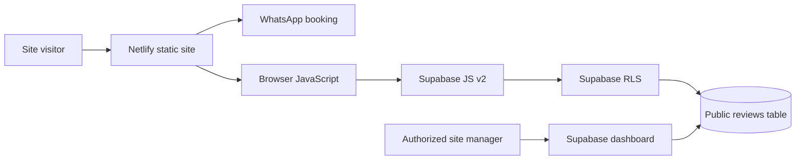

# Architecture

## Components

- `index.html` — accessible bilingual information, responsive page sections, review modal, booking links.
- `styles.css` — unified deep-emerald, cream, and gold design, component layouts and responsive breakpoints.
- `script.js` — navigation, animations, safety modal, scroll-to-top and footer year.
- `review-config.js` — Supabase **public** project URL and publishable key. Never commit secrets.
- `reviews.js` — reads approved reviews and submits pending reviews.
- `supabase/schema.sql` — reference schema and role-based RLS policies for **new** setups. Do not apply blindly to an active database.
- `netlify.toml` — static publishing and HTTP headers.
- `assets/` — self-hosted SVG brand illustration and favicon.

## Important boundaries

There is no private server/API in this repository. Submission integrity and moderation depend on Supabase RLS and database constraints. GitHub Actions validates static structure and JavaScript syntax, **not** live database permissions or appointment delivery.

Existing Netlify production deployment is not changed by GitHub updates unless its deploy settings are connected to this repository.
